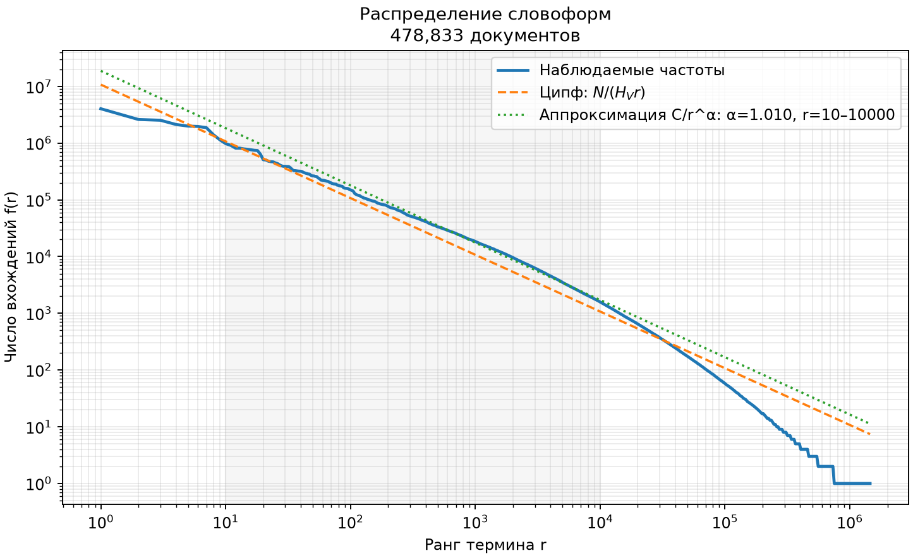
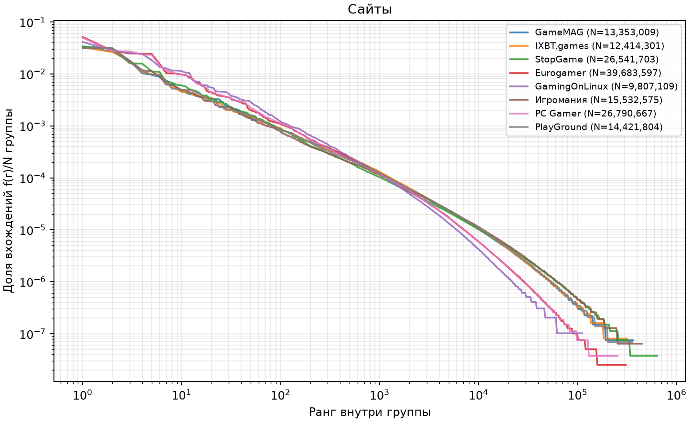
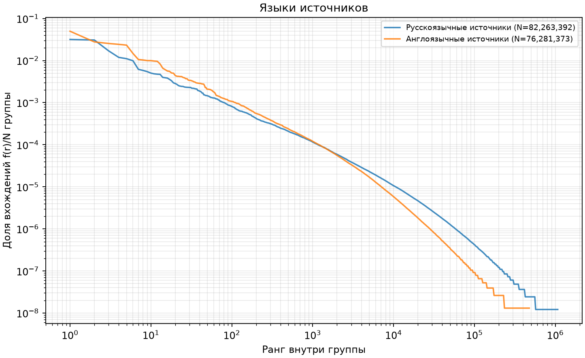
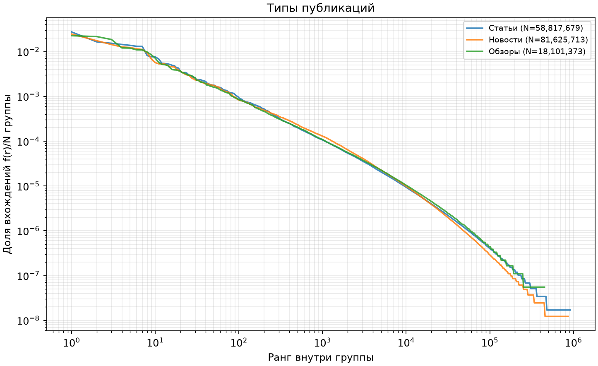
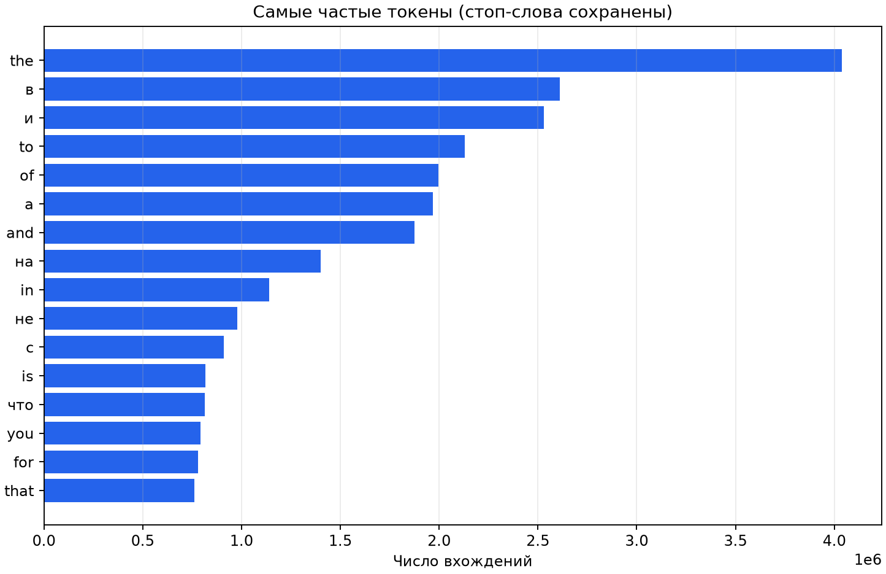

# ЛР5: закон Ципфа

Данные получены собственным C++-счётчиком, а не Python Counter.

Снимок: **478,833 документов**, 1.440 ГБ текста. C++ обработал его за 123.66 с с буфером счётчика 64 МиБ. Это один запуск, не медиана бенчмарка; загрузка MongoDB и построение рисунков в это время не включены.

Однократные токены составляют **49.31% словаря**. Большая доля редких слов объясняет ступенчатый хвост; число hapax не является оценкой числа ошибок текста.

| Группа | Документы | Токены N | Словарь V | Hapax | α |
|---|---:|---:|---:|---:|---:|
| all | 478,833 | 158,544,765 | 1,451,704 | 715,896 | 1.010 |
| source:gamemag | 73,772 | 13,353,009 | 364,833 | 175,267 | 1.011 |
| language:ru | 327,897 | 82,263,392 | 1,071,670 | 513,901 | 0.970 |
| type:article | 58,986 | 58,817,679 | 912,248 | 433,492 | 1.014 |
| type:news | 369,663 | 81,625,713 | 864,997 | 411,167 | 1.030 |
| type:review | 50,184 | 18,101,373 | 449,980 | 200,126 | 0.974 |
| source:ixbt_games | 68,315 | 12,414,301 | 314,938 | 133,930 | 1.007 |
| source:stopgame | 54,358 | 26,541,703 | 636,802 | 297,955 | 0.967 |
| source:eurogamer | 77,772 | 39,683,597 | 307,718 | 152,825 | 1.192 |
| language:en | 150,936 | 76,281,373 | 476,352 | 246,835 | 1.197 |
| source:gamingonlinux | 28,184 | 9,807,109 | 110,486 | 49,661 | 1.313 |
| source:igromania | 50,818 | 15,532,575 | 448,979 | 199,358 | 0.940 |
| source:pcgamer | 44,980 | 26,790,667 | 253,863 | 124,036 | 1.184 |
| source:playground | 80,634 | 14,421,804 | 357,310 | 158,200 | 0.982 |

## Как читать результаты

Частота — число вхождений токена, а не число документов с ним. Ранги начинаются с 1; равенства частот разрешаются лексикографически по UTF-8.
Стоп-слова, цифры, игровые обозначения и словоформы сохранены правилами gaming-v3. Лемматизация не применяется.
Теоретическая кривая f(r)=C/r использует C=N/H_V, H_V=Σ(1/r): её сумма по всему словарю равна N.
Отдельная степень C/r^α подобрана C++ методом наименьших квадратов в log-координатах для рангов 10–10000 (в пределах каждой группы). Это другая модель, а не замена закона Ципфа.
Язык назначается по сайту, не определяется по каждому тексту. В русских публикациях остаются английские названия; это влияет на смешанную кривую.
Тип берётся из parsed.category. Неподдержанные или отсутствующие категории отмечаются unknown; отсутствующие группы не выдумываются.
На графиках сравнения частоты нормированы на число токенов группы. Корпуса разных размеров имеют разные длины хвоста; нормировка этого не устраняет.
Отклонения ожидаемы из-за смешения языков, ограниченной игровой тематики, словоформ, собственных имён, новостей разной длины и конечного размера корпуса. Редкий хвост имеет ступени частот 1, 2, 3 и не образует идеальную прямую.
Близость к прямой не доказывает качество парсинга и не является оценкой релевантности поиска.
Целиком хранится только текущий текстовый буфер; таблица частот ограничена заданным бюджетом и сбрасывается отсортированными частями. Слияние открывает не более 24 входных файлов. Бюджет counting_buffer_bytes не включает поле документа, буферы слияния и токенизатор.
Графики используют логарифмическую выборку точек для отрисовки; полные частоты сохранены в counted/frequencies.tsv локального каталога запуска.
Снимок фиксирован файлом и SHA-256. Сам экспорт MongoDB курсором не является транзакционным снимком коллекции.
