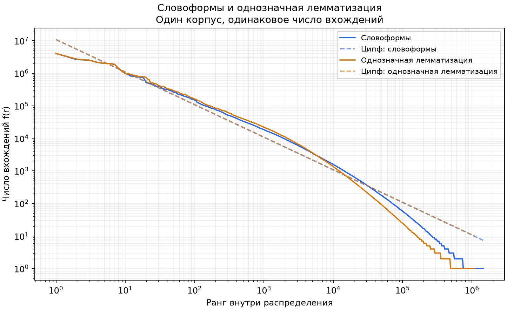
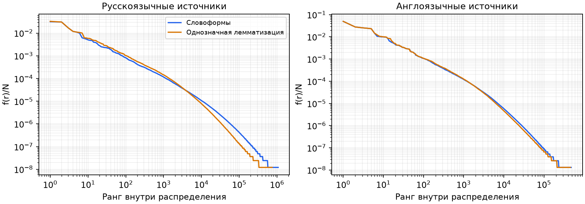
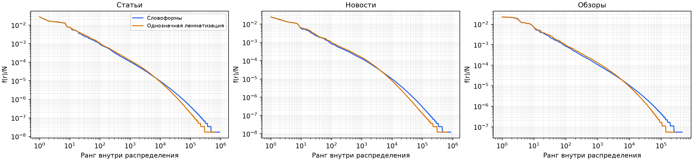
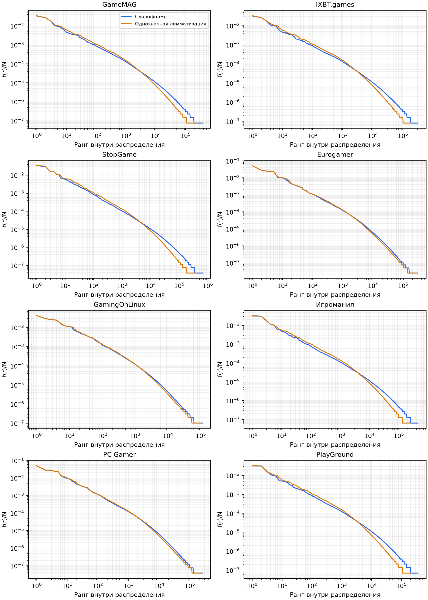

# Словоформы и лемматизация

Одинаковый снимок, поля и группы; одно исходное вхождение даёт ровно одно вхождение в обоих вариантах.

Однозначные разборы заменяются леммой; неоднозначные и неизвестные слова сохраняются. Контекстное снятие омонимии не выполняется.

Изменены 36,378,114 вхождений. Неоднозначные разборы: 17,237,972; они не размножаются по вариантам.

| Группа | Словарь словоформ | После лемматизации | Сокращение, % | α словоформ | α после |
|---|---:|---:|---:|---:|---:|
| all | 1,451,704 | 1,104,683 | 23.90 | 1.0098 | 1.0944 |
| source:gamemag | 364,833 | 232,292 | 36.33 | 1.0111 | 1.1760 |
| language:ru | 1,071,670 | 741,955 | 30.77 | 0.9697 | 1.1351 |
| type:article | 912,248 | 628,010 | 31.16 | 1.0145 | 1.0770 |
| type:news | 864,997 | 650,031 | 24.85 | 1.0302 | 1.1347 |
| type:review | 449,980 | 271,022 | 39.77 | 0.9742 | 1.0653 |
| source:ixbt_games | 314,938 | 184,918 | 41.28 | 1.0065 | 1.1879 |
| source:stopgame | 636,802 | 386,842 | 39.25 | 0.9667 | 1.1135 |
| source:eurogamer | 307,718 | 287,507 | 6.57 | 1.1919 | 1.2750 |
| language:en | 476,352 | 453,003 | 4.90 | 1.1969 | 1.2829 |
| source:gamingonlinux | 110,486 | 100,146 | 9.36 | 1.3134 | 1.4065 |
| source:igromania | 448,979 | 258,805 | 42.36 | 0.9396 | 1.1013 |
| source:pcgamer | 253,863 | 234,987 | 7.44 | 1.1845 | 1.2721 |
| source:playground | 357,310 | 209,109 | 41.48 | 0.9819 | 1.1845 |

Пунктир — теоретическая модель Ципфа с фиксированной степенью 1 и нормировкой N/H_V отдельно для каждого словаря.
α оценена по данным на рангах 10–10000. При изменении единицы подсчёта состав терминов на этих рангах меняется.
Результат характеризует указанную консервативную политику и данный словарь; его нельзя выдавать за контекстно разрешённую лемматизацию всего корпуса.
