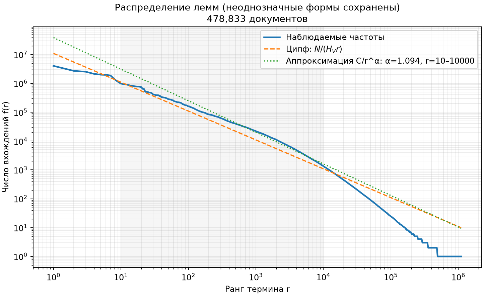
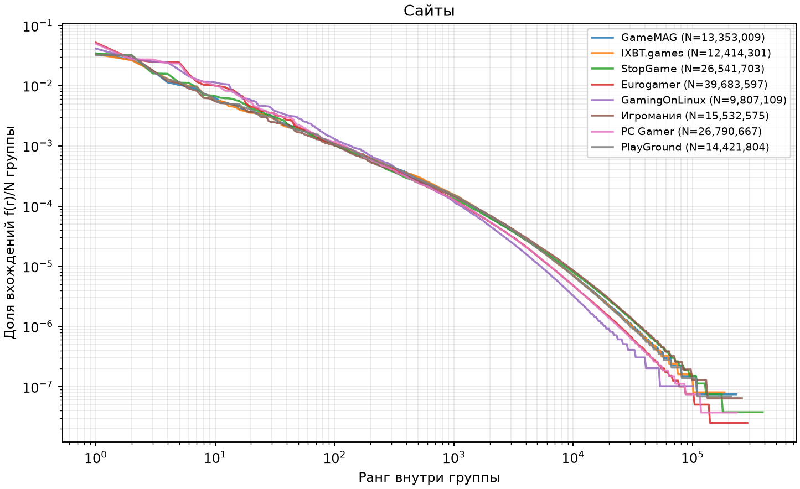
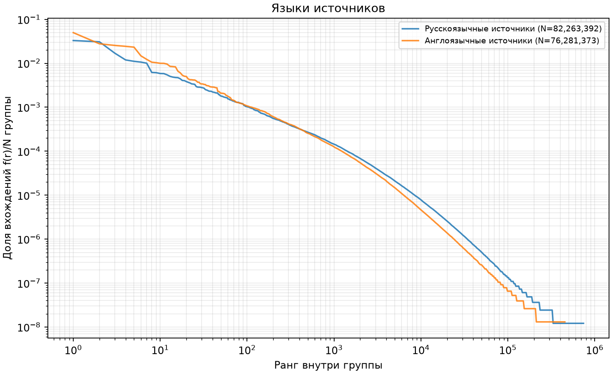
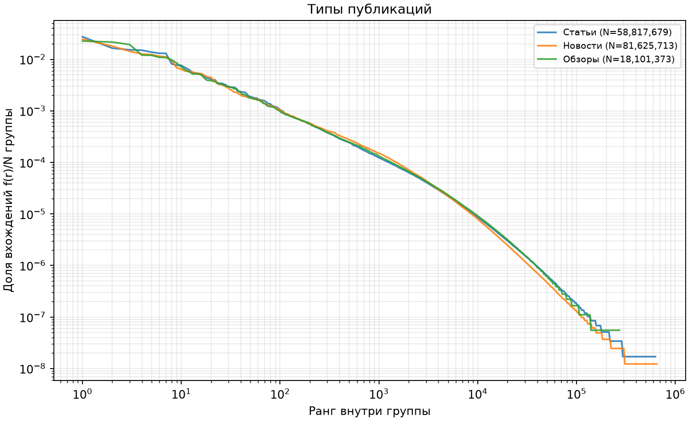
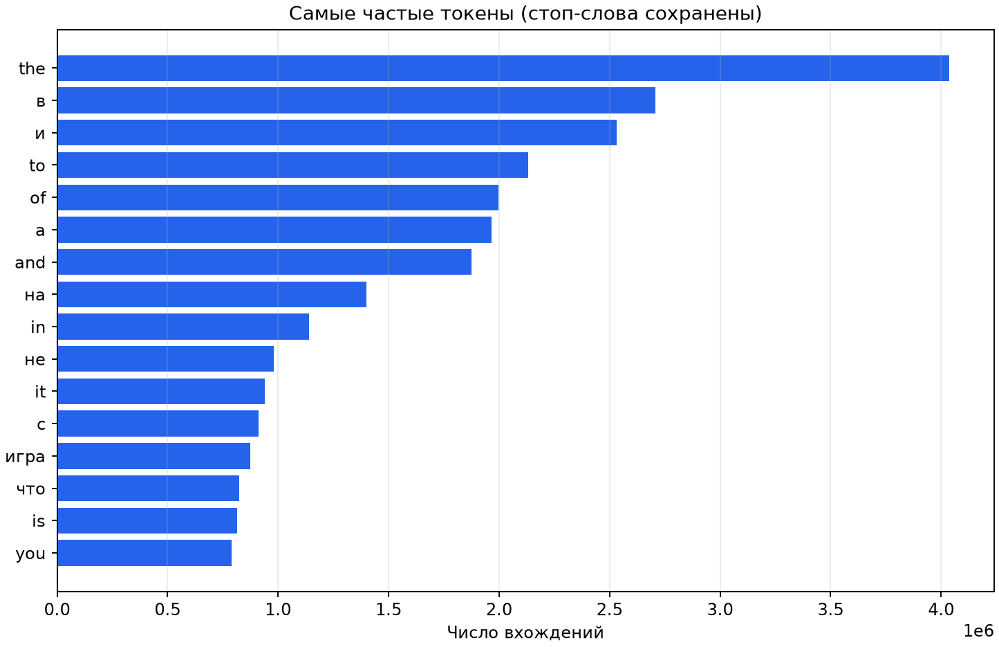

# ЛР5: закон Ципфа

Данные получены собственным C++-счётчиком, а не Python Counter.

Снимок: **478,833 документов**, 1.440 ГБ текста. C++ обработал его за 178.92 с с буфером счётчика 64 МиБ. Это один запуск, не медиана бенчмарка; загрузка MongoDB и построение рисунков в это время не включены.

Однократные токены составляют **55.54% словаря**. Большая доля редких слов объясняет ступенчатый хвост; число hapax не является оценкой числа ошибок текста.

| Группа | Документы | Токены N | Словарь V | Hapax | α |
|---|---:|---:|---:|---:|---:|
| all | 478,833 | 158,544,765 | 1,104,683 | 613,533 | 1.094 |
| source:gamemag | 73,772 | 13,353,009 | 232,292 | 123,667 | 1.176 |
| language:ru | 327,897 | 82,263,392 | 741,955 | 413,366 | 1.135 |
| type:article | 58,986 | 58,817,679 | 628,010 | 337,518 | 1.077 |
| type:news | 369,663 | 81,625,713 | 650,031 | 342,901 | 1.135 |
| type:review | 50,184 | 18,101,373 | 271,022 | 131,288 | 1.065 |
| source:ixbt_games | 68,315 | 12,414,301 | 184,918 | 84,196 | 1.188 |
| source:stopgame | 54,358 | 26,541,703 | 386,842 | 209,889 | 1.113 |
| source:eurogamer | 77,772 | 39,683,597 | 287,507 | 148,873 | 1.275 |
| language:en | 150,936 | 76,281,373 | 453,003 | 242,705 | 1.283 |
| source:gamingonlinux | 28,184 | 9,807,109 | 100,146 | 46,873 | 1.406 |
| source:igromania | 50,818 | 15,532,575 | 258,805 | 126,666 | 1.101 |
| source:pcgamer | 44,980 | 26,790,667 | 234,987 | 120,127 | 1.272 |
| source:playground | 80,634 | 14,421,804 | 209,109 | 101,890 | 1.185 |

## Как читать результаты

Частота — число вхождений токена, а не число документов с ним. Ранги начинаются с 1; равенства частот разрешаются лексикографически по UTF-8.
Применяется консервативная лемматизация: однозначные разборы объединяются, неоднозначные и неизвестные словоформы сохраняются. Каждое исходное вхождение учитывается ровно один раз.
Теоретическая кривая f(r)=C/r использует C=N/H_V, H_V=Σ(1/r): её сумма по всему словарю равна N.
Отдельная степень C/r^α подобрана C++ методом наименьших квадратов в log-координатах для рангов 10–10000 (в пределах каждой группы). Это другая модель, а не замена закона Ципфа.
Язык назначается по сайту, не определяется по каждому тексту. В русских публикациях остаются английские названия; это влияет на смешанную кривую.
Тип берётся из parsed.category. Неподдержанные или отсутствующие категории отмечаются unknown; отсутствующие группы не выдумываются.
На графиках сравнения частоты нормированы на число токенов группы. Корпуса разных размеров имеют разные длины хвоста; нормировка этого не устраняет.
Отклонения ожидаемы из-за смешения языков, ограниченной игровой тематики, словоформ, собственных имён, новостей разной длины и конечного размера корпуса. Редкий хвост имеет ступени частот 1, 2, 3 и не образует идеальную прямую.
Близость к прямой не доказывает качество парсинга и не является оценкой релевантности поиска.
Целиком хранится только текущий текстовый буфер; таблица частот ограничена заданным бюджетом и сбрасывается отсортированными частями. Слияние открывает не более 24 входных файлов. Бюджет counting_buffer_bytes не включает поле документа, буферы слияния и токенизатор.
Графики используют логарифмическую выборку точек для отрисовки; полные частоты сохранены в counted/frequencies.tsv локального каталога запуска.
Снимок фиксирован файлом и SHA-256. Сам экспорт MongoDB курсором не является транзакционным снимком коллекции.
